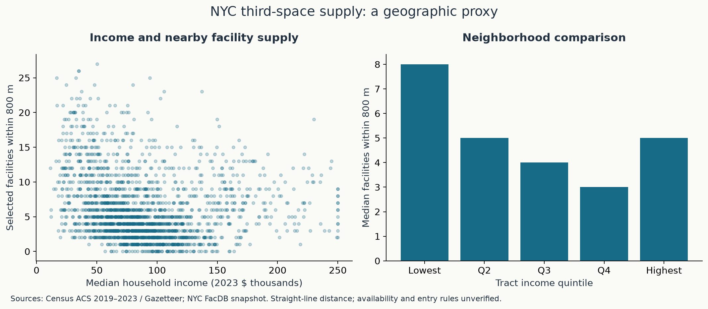

# EconHack 2026 · Third spaces

Data, graphs and code I've put together for Pace's EconHack 2026. The focus is third spaces, who has nearby facilities, and how those patterns relate to social connection and local business activity.

## What's here?

| Resource | What you'll find |
| --- | --- |
| **[Graph guide](docs/graph_guide.md)** | Each graph explained briefly, with links to its data and results |
| **[Processed data](data/processed/README.md)** | A file-by-file guide to the CSVs you can download and use |
| **[Data dictionary](docs/data_dictionary.md)** | Variable names, definitions, units and sources |
| [Graphs](outputs/figures) | PNG images and SVG versions for slides |
| [Results tables](outputs/tables) | Regression estimates, confidence intervals and summary statistics |
| [Findings](docs/findings.md) | A summary of the current results and their limits |
| [Notebooks](notebooks) | The calculations behind the analyses |
| [Methods overview](docs/research_protocol.md) | Equations, samples and the main data limitations |

The CSVs open in Excel, Google Sheets, R or Python. Figures and results are already saved in the repository. The notebooks and source code are there if you want to check or change the analysis.

## What the data cover

| Topic | Data | Main dataset |
| --- | --- | --- |
| Nearby public facilities in NYC | Census demographics and NYC facilities | [NYC access](data/processed/nyc_access.csv) |
| Access and loneliness | NYC access matched with CDC modeled adult loneliness | [NYC loneliness](data/processed/nyc_loneliness.csv) |
| Café-like establishments and business applications | Census data for all 62 NY counties, 2018–2023 | [County-year panel](data/processed/panel_county_year.csv) |
| Time spent socializing | BLS published national estimates, age 15+, 2003–2024; 2020 missing | [Annual time-use data](data/processed/atus_published_annual.csv) |

The [processed-data guide](data/processed/README.md) also lists the Census extracts, facility records and other supporting files.



## A few limits to keep in mind

- Nearby facilities are counted within 800 metres of a Census tract reference point, using straight-line distance. That doesn't tell us about opening hours, cost, walking routes or whether a space welcomes a particular age group.
- CDC loneliness figures are modeled adult area estimates. They are not youth-specific observations, and the facility snapshot is later than the outcome year.
- Café-like establishments are a broader category than cafés. Business applications are not businesses that opened.
- These are exploratory associations, not causal effects. Census five-year estimates, spatial dependence and source timing also affect interpretation.

The independent Third Place Index is covered in a [separate comparison](docs/models/third_place_index.md). Its row-level data are not redistributed here. The age-15–24 time-use analysis is incomplete because the microdata download was blocked. A library intervention study is [not estimated](docs/models/library_did.md) because the necessary verified pre/post data weren't established. The [status file](outputs/model_status.json) records what ran.

## Sources

The main sources are BLS ATUS, Census ACS/CBP/BFS, CDC PLACES and NYC Open Data. Source links and definitions are in the [model notes](docs/models). The [source manifest](data/manifest.json) records download URLs, dates and file hashes; the [processed manifest](data/processed_manifest.json) records the CSV lineage and hashes.

Small official source snapshots are in [raw data](data/raw). Large national files are left out of GitHub; the download code is included. Reuse terms are in [data licenses](DATA_LICENSES.md). No software license has been selected for the project code.

<details>
<summary><strong>Run the analysis yourself</strong></summary>

Use Python 3.13 for the tested environment. From the repository folder:

```sh
python3.13 -m venv .venv
source .venv/bin/activate
python -m pip install -r requirements.lock
python -m pip install --no-deps -e .
PYTHONPATH=src python -m econhack.cli verify
python -m pytest -q
PYTHONPATH=src python -m econhack.cli run --offline
PYTHONPATH=src python scripts/build_notebooks.py --execute
```

The explicit source path also avoids an editable-install issue found on some Macs. Offline runs use the included processed extracts. GitHub Actions checks tests, file integrity, offline reproduction and notebook execution.

For source acquisition/rebuild, omit `--offline`. Missing source files are downloaded where available, while existing caches remain hash-checked. To run one module, add `--model nyc`, `panel`, `atus`, `supplements` or `third_place_index`.

For a fresh source vintage, use a separate checkout or archive the existing data, manifests and results together before replacing caches. A refresh can change definitions, coverage and results. Keep the originals.

</details>

<details>
<summary><strong>Folder map</strong></summary>

```text
data/processed/    CSVs and a file-by-file guide
data/raw/          Included source snapshots
docs/              Graph guide, definitions, findings and methods
notebooks/         Executed analysis notebooks
outputs/figures/   PNG and SVG graphs
outputs/tables/    Results and summary tables
outputs/qa/        Data checks and diagnostics
src/econhack/      Download, cleaning and analysis code
tests/            Automated checks
```

</details>
