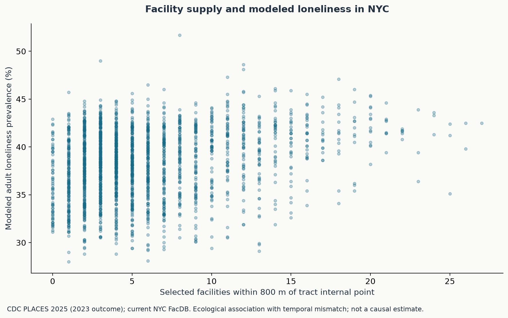
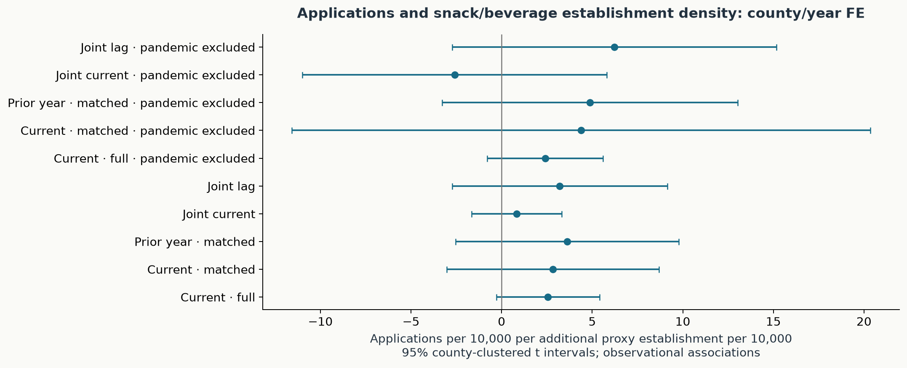
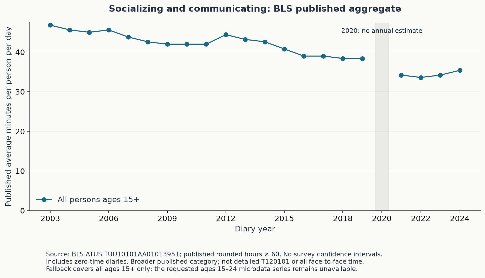

# Findings from the verified snapshot

These are exploratory findings, not causal policy effects. Estimates below refer to the downloaded snapshot in `data/manifest.json`; the tables and code are the source of numerical detail. The development plan was not preregistered. A result contrary to an initial hypothesis remains in the repository.

## NYC: facility supply is not a simple income gradient

The official inventory contains **34,446 facility records**. The conservative allow-list retains **1,541 site-category records** after ten duplicate-coordinate/category records are removed. Three selected records lack usable coordinates and are excluded from nearby counts. The inventory covers 959 park/playground sites, 305 senior centers, 223 libraries, and 54 generic community centers. These are selected administrative locations; they are not an exhaustive or operationally audited list of third places.

ACS/Gazetteer keys match across **2,327 NYC tracts**. The regression retains **2,190** populated complete cases. Exact exclusions and all missingness counts are in [QA](../outputs/qa). Nearby supply counts sites within 800 metres of a tract internal point, rather than walking distance from every resident.

The median nearby count by ascending tract-income quintile is **8, 5, 4, 3, 5**. This nonmonotonic pattern does not support a blanket statement that richer neighborhoods always have more selected public facilities. Private/commercial third places, fees, hours, accessibility, capacity, and whether residents feel welcome are outside this exposure.

In the adjusted log(1+access) model, the income coefficient is **−0.069** with approximate spatial-grid-clustered 95% interval **[−0.207, 0.069]**. Poverty has a positive conditional coefficient, contrary to the initial negative hypothesis. Youth share (15–24) has coefficient **−0.00567** per percentage point, spatial interval **[−0.01016, −0.00119]**; the older-adult share also has a negative conditional association. These coefficients concern transformed supply, conditional on borough/density and other covariates. They do not measure an effect of income, age, or poverty on provision.

Residual spatial dependence is substantial: Moran's I is approximately **0.502** for equity and **0.545** for loneliness, each permutation p=**0.002** with 499 permutations. The grid-cluster sensitivities broaden intervals, but do not establish that all dependence has been addressed. Covariate collinearity, ACS measurement error, top-coded income, and geographic aggregation remain concerns.

## Loneliness: no clear adjusted association in this specification

On the same 2,190-tract sample, the coefficient on log(1+nearby supply) is **−0.177 percentage points** per log unit. HC3 95% interval is approximately **[−0.367, 0.014]**; the spatial-grid sensitivity is **[−0.499, 0.146]**. Both include zero. This is an imprecise conditional association, not proof that third spaces have no benefit.

The outcome is **CDC's modeled crude adult prevalence**, reference year 2023, released in 2025. It shares demographic inputs with explanatory covariates and predates the current facility snapshot. Those features, plus ecological inference and endogenous facility placement, rule out a causal interpretation. These results cannot establish how teenagers or library users feel.

## County panel: complete data, imprecise associations

All **372 county-years** (62 NY counties, 2018–2023) have usable official CBP, BFS, and ACS records. All eight specified county/year FE models are estimable. The main exposure is **NAICS 722515 employer snack/nonalcoholic beverage establishments per 10,000 residents**, broader than cafés. The outcome is **business applications per 10,000**, not realized businesses or growth.

The full-sample contemporaneous coefficient is **2.56**, with county-clustered 95% interval **[−0.29, 5.41]**. On the identical 310-row current/lag sample, the lag coefficient is **3.62**, interval **[−2.54, 9.78]**. The intervals cross zero; pandemic-exclusion and joint current/lag specifications are also imprecise. Do not select a preferred positive point estimate and treat it as a return to a café intervention.

The panel is short, both rates share rolling ACS denominators, and some sensitivity observations have very high leverage. County and year effects remove stable county differences/common annual shocks, but not time-varying local confounders. Missingness and suppression are separately tracked even though this selected snapshot has complete current-model coverage.

## Independent index: a materially different construct

Third Place Index schema/identity checks cover **84,414 source tracts**, with **2,327 NYC matches** and no duplicate primary keys or category-total mismatches. Spearman agreement between its broad within-tract venue count and official selected facilities within 800 m is **0.240**. The measures are not interchangeable: commercial/OSM categories, within-tract versus nearby supply, coverage, and source timing differ.

The archive README identifies release-specific corrections not fully reflected by the website, including a warning about area/density accuracy. This project does not use TPI area/density in models. Compiled-index redistribution permission is unresolved, so the source archive stays local and public outputs contain only schema, pooled QA counts, and coarse aggregate comparisons. See [the source audit](models/third_place_index.md).

## Time trend and intervention boundary

The official BLS published aggregate for all persons age 15+ falls from **0.78 hours/day (46.8 minutes)** in 2003 to **0.59 hours/day (35.4 minutes)** in 2024. The difference is **−11.4 minutes/day** (approximately −24.4%). These are conversions of rounded published hours, not unrounded microdata estimates or a significance test. A descriptive linear fit over the 21 available annual observations has slope **−0.585 minutes/day per calendar year**. No comparable annual value is inserted for 2020, and no confidence intervals are invented.

The BLS microdata ZIP returned HTTP 403 in this environment. The project includes its verified parser/weighting design and tests, but does not claim age 15–24 results without the data. The published category is broader than detailed activity T120101 and does not cover every face-to-face interaction. It must not be represented as the blocked youth series. See [time-use methods](models/atus_published.md) and the live [status registry](../outputs/model_status.json).

The library DiD/event study remains **not estimated**: no verified event ledger, credible controls, and aligned direct pre/post outcome panel were established. Current directories and CDC modeled estimates do not satisfy that requirement. The [future evaluation gate](models/library_did.md) explains the evidence needed.

## Policy use

Use this project to identify evidence gaps, compare candidate neighborhoods, and design a pilot evaluation. Combine administrative supply with opening hours, prices, youth/older-adult entry rules, mobility barriers, utilization, community consultation, and directly measured social connection before choosing a location or claiming benefits. The student brief turns these gaps into explicit implementation and evaluation requirements.
